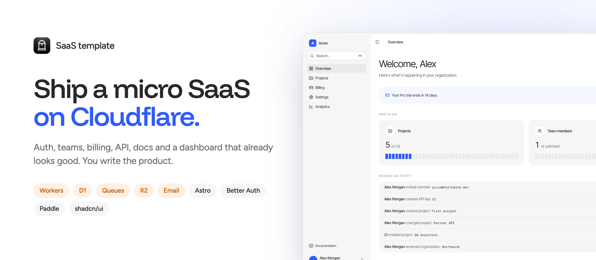
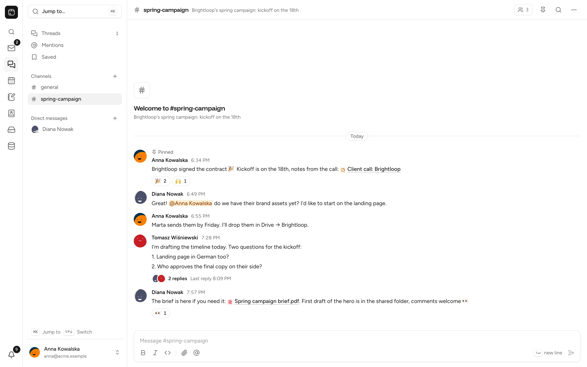
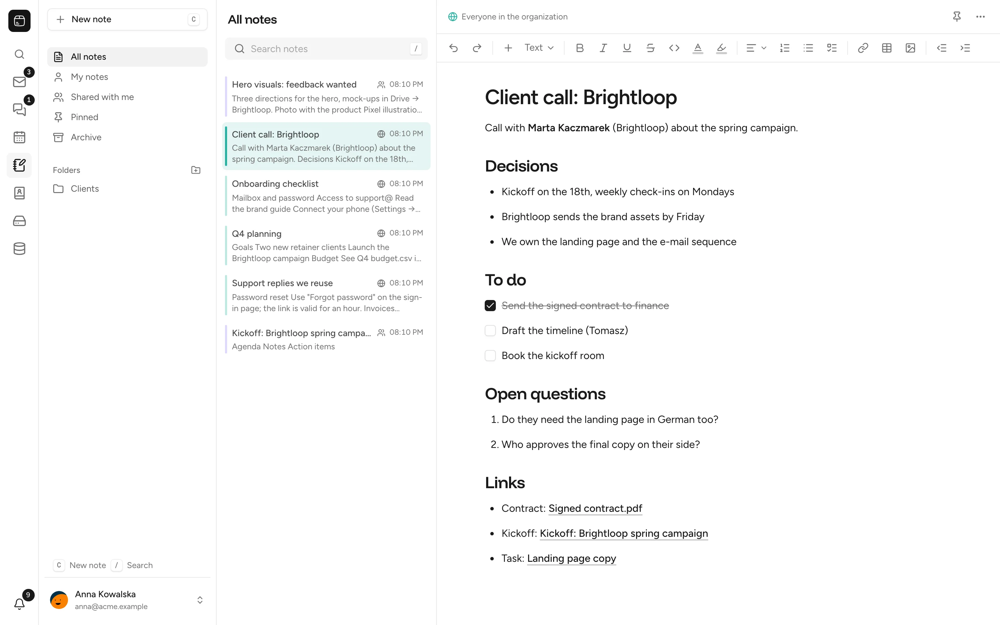
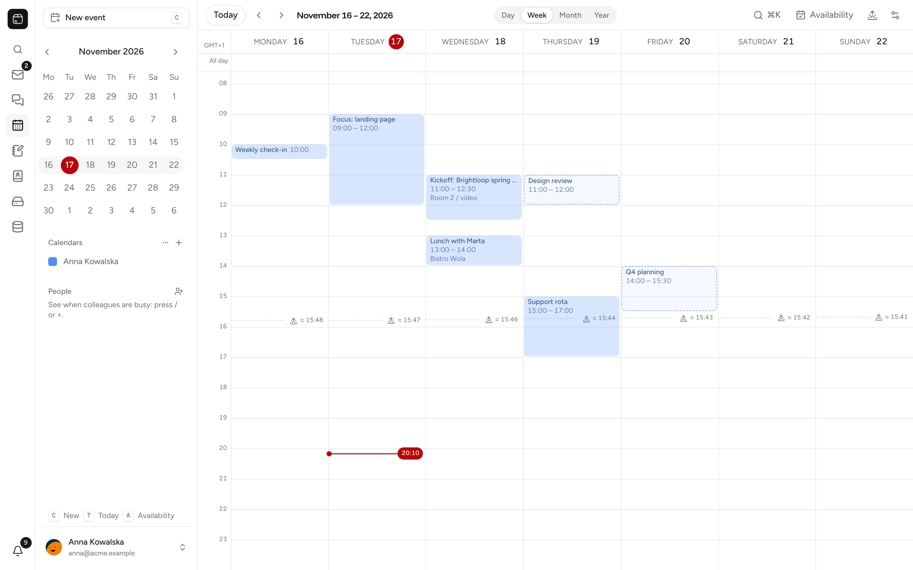
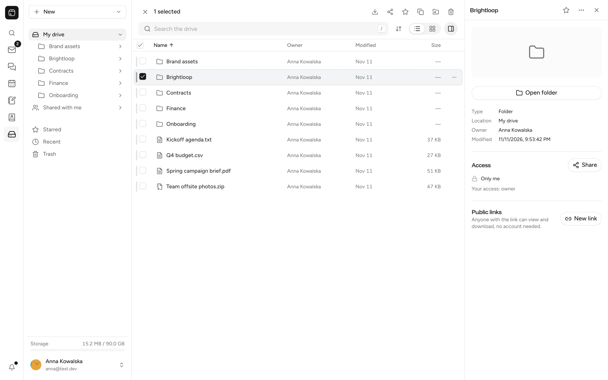
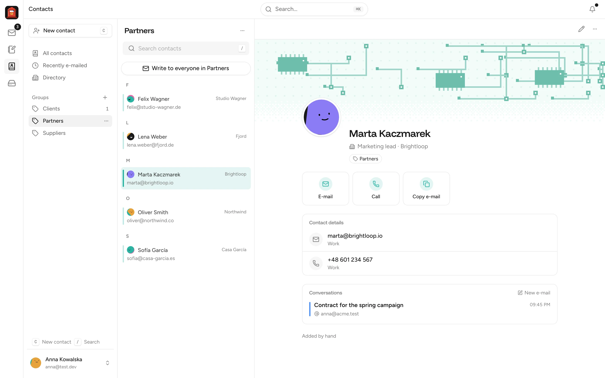
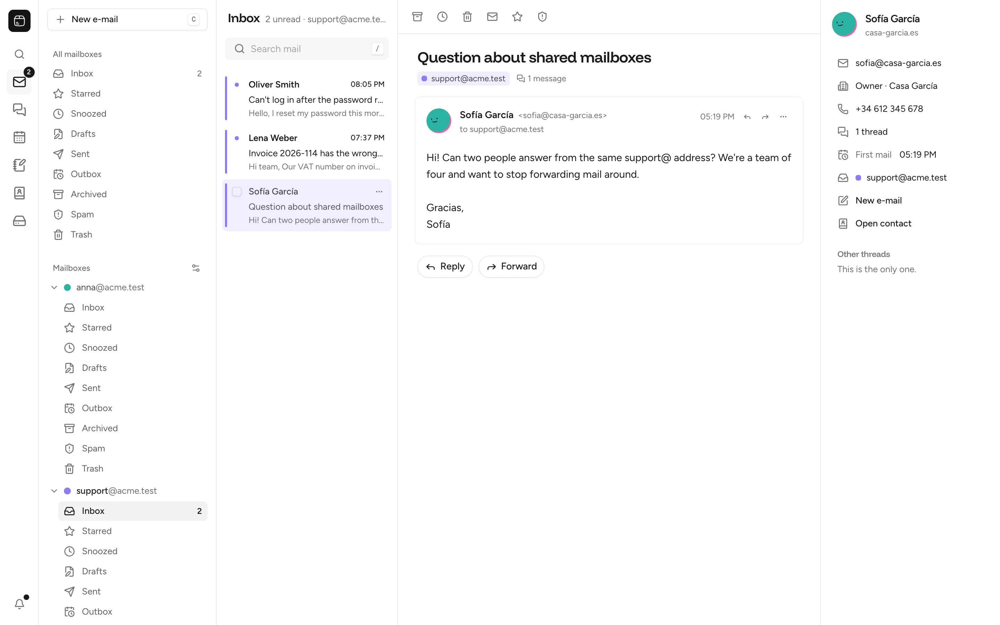
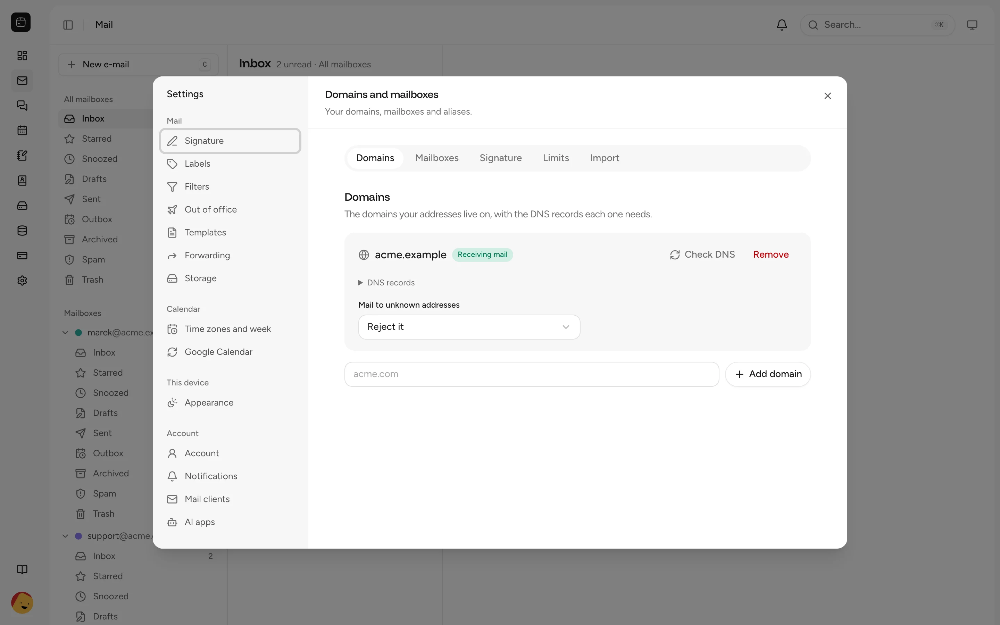
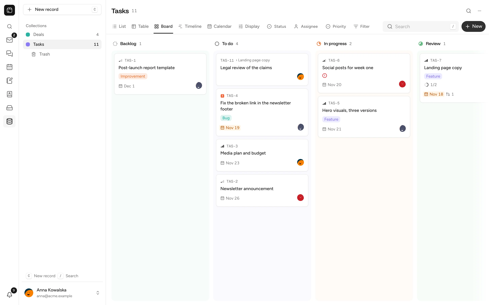

<picture>
  <source media="(prefers-color-scheme: dark)" srcset="docs/banner/banner-dark.png" />
  
</picture>

# Work Inbox

[](LICENSE)
[](https://github.com/workinbox-io/inbox/actions/workflows/ci.yml)

The open-source workspace for your team: email on your own domain, chat, shared notes, calendars, a shared drive,
contacts and lists you design yourself, in one app on Cloudflare. A Google Workspace alternative for small teams: hosted at
[workinbox.io](https://workinbox.io), or self-hosted on your own Cloudflare account.

[Website](https://workinbox.io) · [Docs](https://workinbox.io/docs) · [Self-hosting guide](https://workinbox.io/docs/self-host) · [Roadmap](ROADMAP.md)

## What's inside

Seven apps that share the same people, sign-in, search, @mentions and ⌘K:

- **[Mail](https://workinbox.io/custom-domain-email)**: a personal mailbox per person on your domain, shared mailboxes
  (support@, sales@) answered from the shared address, unlimited aliases, a catch-all, filters, labels, signatures,
  out of office, snooze, scheduled and undo send, search operators and keyboard shortcuts. Import from .mbox/.eml.
- **[Chat](https://workinbox.io/team-chat)**: public and private channels, direct messages, threads, mentions,
  reactions, pins, files, live presence and notifications.
- **[Notes](https://workinbox.io/shared-notes)**: live co-editing (Plate + Yjs on Durable Objects), checklists, tables,
  images, @mentions; private, shared with people, or with the whole team.
- **[Calendar](https://workinbox.io/team-calendar)**: personal and shared calendars, colleagues side by side, recurring
  events, time zones, e-mail invitations, meeting notes, Google Calendar sync in and an .ics feed out.
- **[Drive](https://workinbox.io/shared-drive)**: folders and files shared with people or the team, previews, public
  links with a password and expiry, attach from and save to mail.
- **[Contacts](https://workinbox.io/shared-contacts)**: one team address book filled from sent mail, groups, CSV/vCard
  import and export.
- **[Collections](https://workinbox.io/custom-apps)**: lists your company designs itself (equipment, inventory, a simple
  CRM, task boards): your own fields, table and board views, sharing per collection, CSV import (a new collection
  straight from a spreadsheet) and export, @mentions of records, and automations that e-mail people or post in chat.

Owners and admins turn each app on or off for the organization (Settings → Organization → Apps).

Plus an MCP server for Claude, ChatGPT, Claude Code and Cursor across the apps, and a REST API.

Mail also works in Apple Mail, Outlook, Thunderbird and phone mail apps over IMAP and SMTP (self-hosted: with the
optional mail bridge in `infra/mail`). Not yet: CalDAV, voice and video calls, and native mobile apps.

## Screenshots

| | |
|---|---|
|  |  |
| **Mail**: threads, the sender's card, every mailbox in one list | **Chat**: channels, threads and reactions |
|  |  |
| **Notes**: live co-editing | **Calendar**: the team's week |
|  |  |
| **Drive**: files, sharing, public links | **Contacts**: the team's address book |
|  |  |
| **Shared mailboxes**: support@ answered by the team | **Domains**: DNS records and checks, mailboxes, aliases |
|  | |
| **Collections**: your own lists as a board | |

## Self-hosting

Runs for one company on its own Cloudflare account (Workers, D1, R2, Queues, Durable Objects, Email Routing and Email
Service), every feature on, no billing. Step by step: [workinbox.io/docs/self-host](https://workinbox.io/docs/self-host)
(source: [`src/content/docs/self-host.md`](src/content/docs/self-host.md)).

```sh
git clone https://github.com/workinbox-io/inbox.git workinbox && cd workinbox
pnpm install && pnpm run setup # your domain, DEPLOY_MODE "self", D1, R2 and the queues
pnpm run deploy                # build, migrate, deploy
```

## Tech stack

Cloudflare Workers, D1 (SQLite) with Drizzle, R2, Queues, Durable Objects, Email Routing and Email Service · Astro SSR
with React islands, Tailwind and shadcn/ui · Better Auth with organizations · Plate + Yjs for notes · Paddle for the
hosted plans (off when self-hosted).

## Contributing

Issues and pull requests are welcome: see [CONTRIBUTING.md](CONTRIBUTING.md). Report vulnerabilities privately, as
described in [SECURITY.md](SECURITY.md). Product notes for contributors and coding agents: [CLAUDE.md](CLAUDE.md) / [AGENTS.md](AGENTS.md).

## License

[AGPL-3.0](LICENSE). You can run, change and self-host Work Inbox freely; if you offer a modified version as a service
to others, publish your changes under the same licence.

## Developer guide

Built on a shared SaaS template for Cloudflare Workers (Astro SSR + React islands, D1 + Drizzle, Better Auth, Paddle);
the sections below are the developer guide. Product notes for contributors and coding agents: [CLAUDE.md](CLAUDE.md).

### Where things go

```
src/
  config/        site.ts (brand, nav), plans.ts (prices, limits, features), nav.ts (dashboard), audit.ts
  db/schema/     core.ts, admin-mail.ts (template tables) · app.ts (YOUR tables)
  jobs/          index.ts (template jobs) · app.ts, app-cron.ts (YOUR jobs and daily tasks)
  mcp/           MCP tools: core.ts (template) · app.ts (YOUR tools and widgets) · widgets/*.tsx
  lib/server/    domain logic: auth, org, billing, paddle, api-keys, audit, errors, analytics, oauth, mcp,
                 email, uploads, admin-mail, mail/, notes/, contacts
  lib/           pure modules shared with tests: validation, uploads, mail/ (threading, quotes), admin-mail/ (rules)
  pages/         marketing (prerendered), /app (dashboard), /api/app (session), /api/v1 (API keys), /mcp, /oauth
  components/    ui/ (shadcn + dashboardcn), app/ (dashboard), site/ (marketing), auth/, docs/,
                 admin-mail/ (staff mailboxes), uploads/ (attachment picker), storyboard/ (animated diagrams)
  emails/        React Email templates
  content/docs/  docs as Markdown
  worker.ts      Worker entry: Astro + queue consumer + cron + incoming e-mail
```

Marketing pages can show an animated diagram of how the product works: describe a scene with
`defineScene()` and render it with `<Scene />` (`src/components/storyboard`, start from
`scenes/example.ts`; its README has the details).

#### Conventions

- Domain logic lives in `src/lib/server`; API routes and pages stay thin.
- API routes use `handler()` / `manageHandler()` from `lib/server/api.ts`: throw `HttpError`, validate
  with `parseBody(request, schema)` (schemas in `lib/validation.ts`), call `audit()` for changes.
- Every query is scoped to `locals.orgId`. `/api/v1` routes can re-export the `/api/app` handlers:
  the middleware puts the API key's org and role in the same place.
- D1 has no interactive transactions: use `db.batch([...])` for writes that belong together.
- Queue handlers and cron tasks must be idempotent (they're retried).
- Bindings and secrets come from `import { env } from "cloudflare:workers"`. After changing
  `wrangler.jsonc` run `pnpm cf-types`.

### Commands

```sh
pnpm dev                  # astro dev in workerd
pnpm typecheck            # wrangler types + astro sync + tsc
pnpm test                 # vitest (pure modules in test/)
pnpm build
pnpm db:generate          # SQL migration from schema changes (drizzle-kit)
pnpm db:migrate           # apply to local D1 · db:migrate:remote for production
pnpm paddle:sync          # create Paddle products and prices from config/plans.ts
pnpm run deploy           # build, migrate remote D1, wrangler deploy
pnpm template:update      # merge the latest template (TEMPLATE.md)
```

### Updating from the template

Work Inbox is built on a private SaaS template that its maintainers merge in from time to time
([TEMPLATE.md](TEMPLATE.md)). Contributors don't need it.

### Going to production (self-hosted)

Follow the [self-hosting guide](https://workinbox.io/docs/self-host) (`src/content/docs/self-host.md`). In short:

1. `pnpm run setup`: points `wrangler.jsonc` at your domain, sets `DEPLOY_MODE=self`, turns workinbox.io's own services
   off, makes your IndexNow key and, if you want, creates D1, R2 and the queues. Queues and password hashing need the
   **Workers Paid** plan.
2. **E-mail**: onboard the domain in Cloudflare Email Service and add an Email Routing rule "Send to Worker".
3. **Secrets**: `wrangler secret put BETTER_AUTH_SECRET`; the optional ones are listed in `.dev.vars.example`.
4. `pnpm run deploy` (applies the D1 migrations, deploys, then pings IndexNow with the sitemap's URLs).
5. **Mail apps** (optional): IMAP/SMTP through the mail bridge in `infra/mail`, then `MAIL_CLIENT_HOST`,
   `MAIL_BRIDGE_URL` and `MAIL_BRIDGE_TOKEN` (docs: `src/content/docs/mail-clients.md`).

Hosted mode (`DEPLOY_MODE=cloud`, what workinbox.io runs) also uses Paddle for billing (`pnpm paddle:sync`, webhook
`/api/paddle/webhook`) and Amazon SES for the orgs' own domains ([docs/ses.md](docs/ses.md)).
