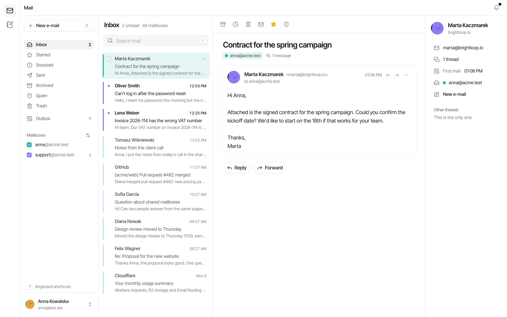

# Work Inbox

Open-source team email on your own domain, with shared notes, running on Cloudflare. A Google Workspace alternative
for small teams: hosted at [workinbox.io](https://workinbox.io), or self-hosted on your own Cloudflare account.



## What it does today

- **Mail on your domains**: a personal mailbox per person, shared mailboxes (support@, sales@) answered by several
  people from the shared address, unlimited aliases, a catch-all per domain, plus addressing, a spam score and sender
  rules, search operators (`from:`, `has:attachment`, `is:unread`…) and keyboard shortcuts.
- **Shared notes**: live co-editing (Plate + Yjs on Durable Objects), checklists, tables, images, @mentions; private,
  shared with people, or with the whole team.
- **Contacts**: one team address book filled from sent mail, CSV/vCard import and export, suggestions in the composer.
- **Importing old mail**: .mbox or .eml files (Gmail Takeout included).
- **AI apps and API**: an MCP server for Claude, ChatGPT, Claude Code and Cursor, and a REST API.

Not yet: IMAP access, mobile apps, calendar and drive (next on the roadmap).

## Self-hosting

Runs for one company on its own Cloudflare account (Workers, D1, R2, Queues, Durable Objects, Email Routing and Email
Service), every feature on, no billing. Step by step: [workinbox.io/docs/self-host](https://workinbox.io/docs/self-host)
(source: `src/content/docs/self-host.md`).

```sh
git clone https://github.com/workinbox-io/inbox.git workinbox && cd workinbox
pnpm install && pnpm setup     # creates D1, R2 and the queues
# set "DEPLOY_MODE": "self" in wrangler.jsonc (billing off, every feature on)
pnpm deploy                    # build, migrate, deploy
```

## License

[AGPL-3.0](LICENSE). You can run, change and self-host Work Inbox freely; if you offer a modified version as a service
to others, publish your changes under the same licence.

Built on a shared SaaS template for Cloudflare Workers (Astro SSR + React islands, D1 + Drizzle, Better Auth, Paddle);
the sections below are the developer guide. Product notes for contributors and coding agents: [CLAUDE.md](CLAUDE.md).

## Where things go

```
src/
  config/        site.ts (brand, nav), plans.ts (prices, limits, features), nav.ts (dashboard), audit.ts
  db/schema/     core.ts, admin-mail.ts (template tables) · app.ts (YOUR tables)
  jobs/          index.ts (template jobs) · app.ts, app-cron.ts (YOUR jobs and daily tasks)
  mcp/           MCP tools: core.ts (template) · app.ts (YOUR tools and widgets) · widgets/*.tsx
  lib/server/    domain logic: auth, org, billing, paddle, api-keys, audit, errors, analytics, oauth, mcp,
                 email, uploads, admin-mail, mail/, notes/, contacts
  lib/           pure modules shared with tests: validation, uploads, mail/ (threading, quotes), admin-mail/ (rules)
  pages/         marketing (prerendered), /app (dashboard), /api/app (session), /api/v1 (API keys), /mcp, /oauth
  components/    ui/ (shadcn + dashboardcn), app/ (dashboard), site/ (marketing), auth/, docs/,
                 admin-mail/ (staff mailboxes), uploads/ (attachment picker), storyboard/ (animated diagrams)
  emails/        React Email templates
  content/docs/  docs as Markdown
  worker.ts      Worker entry: Astro + queue consumer + cron + incoming e-mail
```

Marketing pages can show an animated diagram of how the product works: describe a scene with
`defineScene()` and render it with `<Scene />` (`src/components/storyboard`, start from
`scenes/example.ts`; its README has the details).

### Conventions

- Domain logic lives in `src/lib/server`; API routes and pages stay thin.
- API routes use `handler()` / `manageHandler()` from `lib/server/api.ts`: throw `HttpError`, validate
  with `parseBody(request, schema)` (schemas in `lib/validation.ts`), call `audit()` for changes.
- Every query is scoped to `locals.orgId`. `/api/v1` routes can re-export the `/api/app` handlers:
  the middleware puts the API key's org and role in the same place.
- D1 has no interactive transactions: use `db.batch([...])` for writes that belong together.
- Queue handlers and cron tasks must be idempotent (they're retried).
- Bindings and secrets come from `import { env } from "cloudflare:workers"`. After changing
  `wrangler.jsonc` run `pnpm cf-types`.

## Commands

```sh
pnpm dev                  # astro dev in workerd
pnpm typecheck            # wrangler types + astro sync + tsc
pnpm test                 # vitest (pure modules in test/)
pnpm build
pnpm db:generate          # SQL migration from schema changes (drizzle-kit)
pnpm db:migrate           # apply to local D1 · db:migrate:remote for production
pnpm paddle:sync          # create Paddle products and prices from config/plans.ts
pnpm deploy               # build, migrate remote D1, wrangler deploy
pnpm template:update      # merge the latest template (TEMPLATE.md)
```

## Updating from the template

```sh
git switch -c template-update
pnpm template:update          # or a release: pnpm template:update v1.1.0
pnpm install && pnpm db:generate && pnpm typecheck
```

- Set `TEMPLATE_REPO` (or the URL in `scripts/template-update.sh`) to your template repository once.
- Product code goes in `src/db/schema/app.ts`, `src/jobs/app*.ts`, `src/mcp/app.ts`, `src/config/*`,
  content and new files; then template updates rarely conflict.
- Improvements to shared parts (auth, billing, settings, `components/ui`) are made in the template
  first, tagged, and merged into products.
- Each product owns its migrations: the update skips the template's, and `pnpm db:generate`
  creates one from the merged schema.

The full workflow is in [TEMPLATE.md](TEMPLATE.md); what each release needs by hand is in
[CHANGELOG.md](CHANGELOG.md).

## Going to production

1. **Cloudflare**: `pnpm setup` with "create resources" (or `wrangler d1 create`, `r2 bucket create`,
   `queues create` and put the ids in `wrangler.jsonc`). Add the custom domain to the Worker. Queues
   and Better Auth's password hashing need the **Workers Paid** plan.
2. **E-mail**: onboard the domain in Cloudflare Email Service and set `EMAIL_FROM_ADDRESS`.
3. **Secrets**: `wrangler secret put BETTER_AUTH_SECRET` (+ `GOOGLE_CLIENT_ID/SECRET`,
   `ALERT_EMAIL`, `NOTIFY_EMAIL` as needed). Set `PUBLIC_APP_URL` and `ADMIN_EMAILS` in `vars`.
4. **Paddle**:
   - API key (Customers, Transactions, Subscriptions, Prices, Products, Customer portal sessions: read/write)
     → `wrangler secret put PADDLE_API_KEY`, then `pnpm paddle:sync`.
   - Client-side token → `PUBLIC_PADDLE_CLIENT_TOKEN`. Default payment link → `https://<domain>/pay`.
   - Notification destination `https://<domain>/api/paddle/webhook` with `subscription.*` events →
     its secret in `PADDLE_WEBHOOK_SECRET`. Set `PADDLE_ENV=production` when going live.
5. `pnpm deploy`, or the `Deploy` GitHub workflow (`CLOUDFLARE_API_TOKEN`, `CLOUDFLARE_ACCOUNT_ID`).
   Both end with `pnpm indexnow`, which sends the sitemap URLs to IndexNow (Bing, and through it
   ChatGPT search and Copilot) using the key file `public/<key>.txt` that `pnpm setup` created.
   Also add the domain to Google Search Console and Bing Webmaster Tools and submit `/sitemap-index.xml`.
6. **Staff mailboxes** (optional): list the addresses in `ADMIN_MAILBOXES` and a verified Email
   Routing destination in `ADMIN_MAIL_FORWARD` (`wrangler.jsonc` `vars`), add an Email Routing rule
   "Send to Worker" for each address, and make sure the domain is onboarded in Email Service so
   replies can go out from it. Staff from `ADMIN_EMAILS` then see **Mail** in the sidebar.
