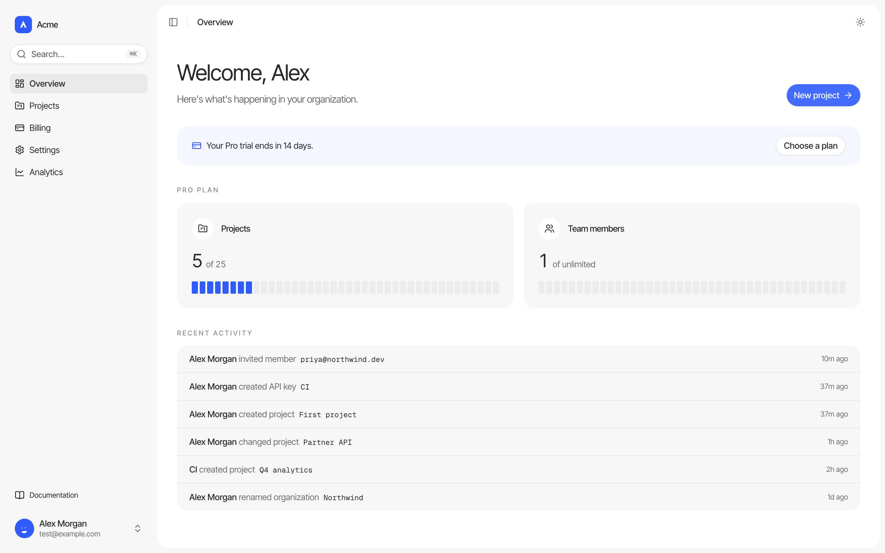
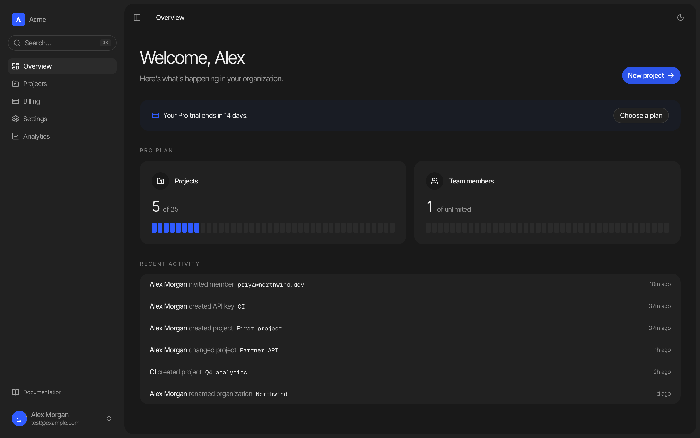
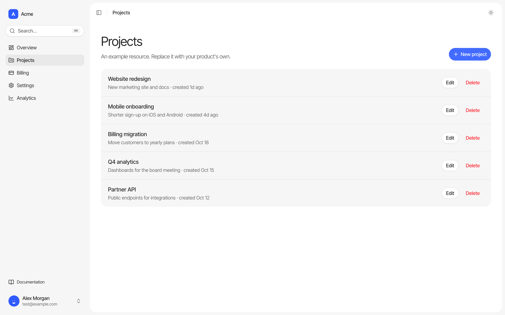
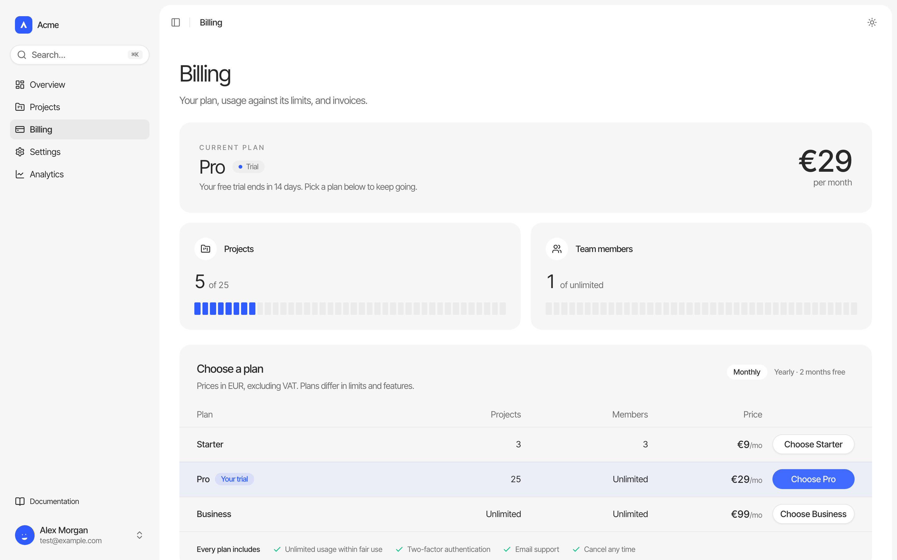
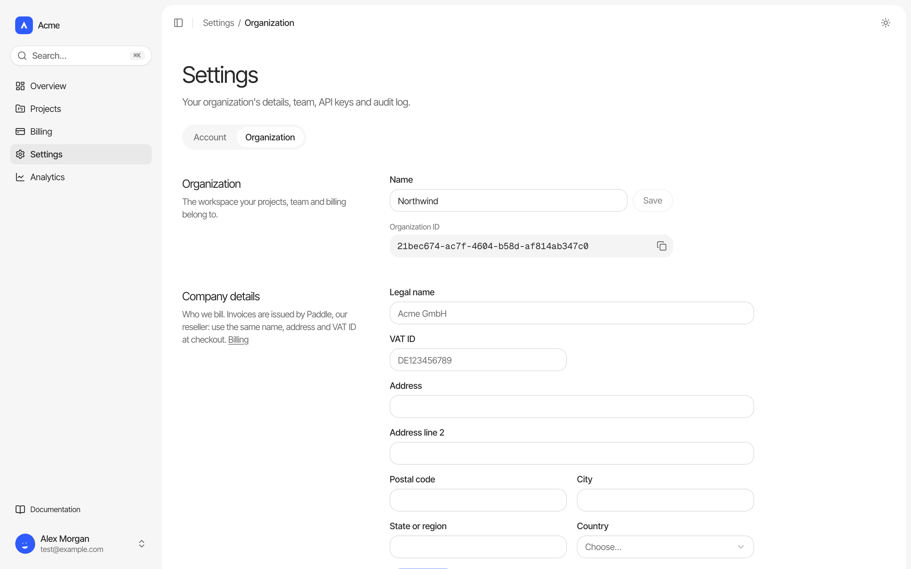
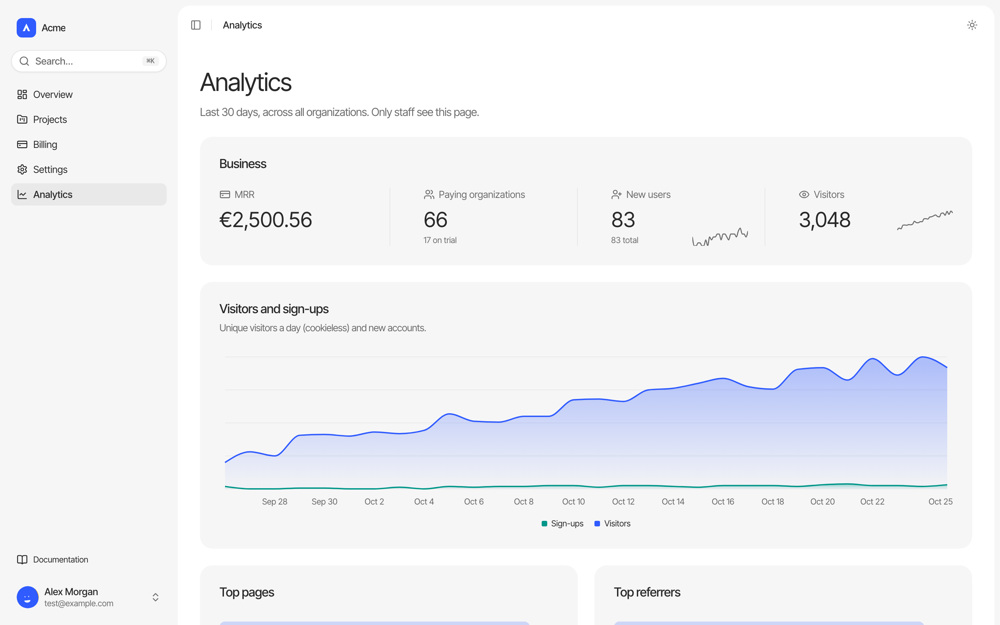
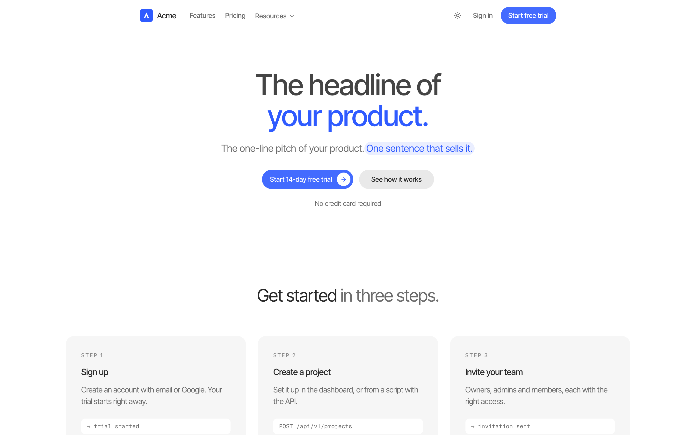
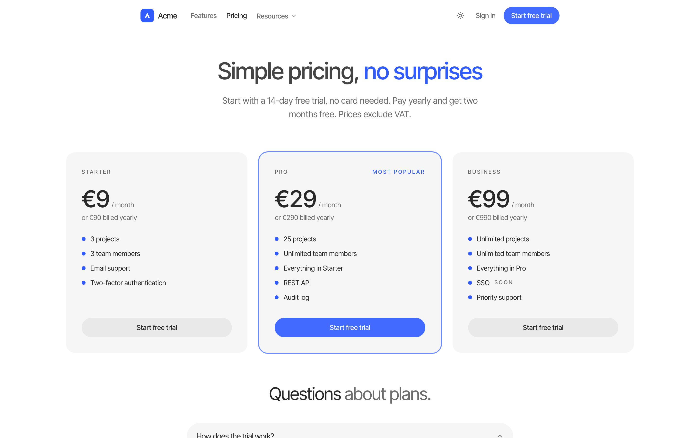

<picture>
  <source media="(prefers-color-scheme: dark)" srcset="docs/banner/banner-dark.png" />
  
</picture>

# SaaS template for Cloudflare

A starting point for a micro SaaS on Cloudflare Workers. It contains everything that isn't the product
itself: marketing site, docs, sign-in, organizations and teams, billing, an API, an audit log and
an admin dashboard. The UI and backend patterns are extracted from CloudFile.

| | |
|---|---|
| App | Astro 7 (SSR) + React islands on **Workers** (`@astrojs/cloudflare`) |
| UI | Tailwind 4, shadcn/ui, dashboardcn (KPI cards, charts, command palette, tables) |
| Database | **D1** + Drizzle (`src/db/schema`, SQL migrations in `migrations/`) |
| Auth | Better Auth: email + password with verification, Google, TOTP 2FA, organizations, invitations |
| Billing | **Paddle** (merchant of record): checkout, customer portal, webhooks, trial |
| E-mail | **Cloudflare Email Service** (`send_email` binding), React Email templates, sent through the queue |
| Jobs | **Queues** (retries with backoff) + **Cron Triggers**, in the same Worker (`src/worker.ts`) |
| Files | **R2** binding `FILES`, ready to use |
| API | `/api/v1` with org API keys, rate limited by the Workers Rate Limiting binding, OpenAPI 3.1 |
| Extras | Audit log, error tracking with e-mail alerts, cookieless analytics, `/app/admin`, `llms.txt` |

## Screenshots

| | |
|---|---|
|  |  |
| Overview: plan usage, trial, recent activity | Every screen in light and dark |
|  |  |
| Example resource with plan limits | Billing with Paddle checkout and portal |
|  |  |
| Organization, team, API keys, audit log | Staff analytics: MRR, sign-ups, traffic |
|  |  |
| Marketing home page | Pricing from `config/plans.ts` |

Screenshots show demo data. Re-take them after UI changes with Playwright against `pnpm dev`;
the header is `docs/banner/banner.html`, rendered by `docs/banner/render.mjs`.

## Starting a new product

Clone the template (don't use GitHub's "Use this template" button: it drops the history, and then
template updates can't be merged; see [TEMPLATE.md](TEMPLATE.md)):

```sh
git clone https://github.com/jakub-kalamarz/saas-template.git my-product && cd my-product
git remote rename origin template
gh repo create my-product --private --source=. --push

pnpm install
pnpm setup                       # name, domain, colors; optionally creates D1, R2 and the queue
cp .dev.vars.example .dev.vars   # BETTER_AUTH_SECRET=$(openssl rand -hex 32)
pnpm db:migrate                  # local D1
pnpm dev                         # http://localhost:4321
```

Locally everything runs in `workerd` (D1, queues and cron included). E-mails are printed to the dev
server log (`astro dev logs`) instead of being sent. Run the cron with
`curl "localhost:4321/cdn-cgi/handler/scheduled?cron=17+3+*+*+*"`.

## Where things go

```
src/
  config/        site.ts (brand, nav), plans.ts (prices, limits, features), nav.ts (dashboard), audit.ts
  db/schema/     core.ts (template tables) · app.ts (YOUR tables)
  jobs/          index.ts (template jobs) · app.ts, app-cron.ts (YOUR jobs and daily tasks)
  lib/server/    domain logic: auth, org, billing, paddle, api-keys, audit, errors, analytics, projects (example)
  pages/         marketing (prerendered), /app (dashboard), /api/app (session), /api/v1 (API keys)
  components/    ui/ (shadcn + dashboardcn), app/ (dashboard), site/ (marketing), auth/, docs/
  emails/        React Email templates
  content/docs/  docs as Markdown
  worker.ts      Worker entry: Astro + queue consumer + cron
```

`projects` is a complete example resource: table, domain logic with a plan limit, routes for the
dashboard and the API, a dashboard page, audit entries and a queue job. Copy it for your first real
resource, then delete it.

### Conventions

- Domain logic lives in `src/lib/server`; API routes and pages stay thin.
- API routes use `handler()` / `manageHandler()` from `lib/server/api.ts`: throw `HttpError`, validate
  with `parseBody(request, schema)` (schemas in `lib/validation.ts`), call `audit()` for changes.
- Every query is scoped to `locals.orgId`. `/api/v1` routes can re-export the `/api/app` handlers:
  the middleware puts the API key's org and role in the same place.
- D1 has no interactive transactions: use `db.batch([...])` for writes that belong together.
- Queue handlers and cron tasks must be idempotent (they're retried).
- Bindings and secrets come from `import { env } from "cloudflare:workers"`. After changing
  `wrangler.jsonc` run `pnpm cf-types`.

## Commands

```sh
pnpm dev                  # astro dev in workerd
pnpm typecheck            # wrangler types + astro sync + tsc
pnpm test                 # vitest (pure modules in test/)
pnpm build
pnpm db:generate          # SQL migration from schema changes (drizzle-kit)
pnpm db:migrate           # apply to local D1 · db:migrate:remote for production
pnpm paddle:sync          # create Paddle products and prices from config/plans.ts
pnpm deploy               # build, migrate remote D1, wrangler deploy
pnpm template:update      # merge the latest template (TEMPLATE.md)
```

## Updating from the template

```sh
git switch -c template-update
pnpm template:update          # or a release: pnpm template:update v1.1.0
pnpm install && pnpm db:generate && pnpm typecheck
```

- Set `TEMPLATE_REPO` (or the URL in `scripts/template-update.sh`) to your template repository once.
- Product code goes in `src/db/schema/app.ts`, `src/jobs/app*.ts`, `src/config/*`, content and new
  files; then template updates rarely conflict.
- Improvements to shared parts (auth, billing, settings, `components/ui`) are made in the template
  first, tagged, and merged into products.
- Each product owns its migrations: the update skips the template's, and `pnpm db:generate`
  creates one from the merged schema.

The full workflow is in [TEMPLATE.md](TEMPLATE.md); what each release needs by hand is in
[CHANGELOG.md](CHANGELOG.md).

## Going to production

1. **Cloudflare**: `pnpm setup` with "create resources" (or `wrangler d1 create`, `r2 bucket create`,
   `queues create` and put the ids in `wrangler.jsonc`). Add the custom domain to the Worker. Queues
   and Better Auth's password hashing need the **Workers Paid** plan.
2. **E-mail**: onboard the domain in Cloudflare Email Service and set `EMAIL_FROM_ADDRESS`.
3. **Secrets**: `wrangler secret put BETTER_AUTH_SECRET` (+ `GOOGLE_CLIENT_ID/SECRET`,
   `ALERT_EMAIL`, `NOTIFY_EMAIL` as needed). Set `PUBLIC_APP_URL` and `ADMIN_EMAILS` in `vars`.
4. **Paddle**:
   - API key (Customers, Transactions, Subscriptions, Prices, Products, Customer portal sessions: read/write)
     → `wrangler secret put PADDLE_API_KEY`, then `pnpm paddle:sync`.
   - Client-side token → `PUBLIC_PADDLE_CLIENT_TOKEN`. Default payment link → `https://<domain>/pay`.
   - Notification destination `https://<domain>/api/paddle/webhook` with `subscription.*` events →
     its secret in `PADDLE_WEBHOOK_SECRET`. Set `PADDLE_ENV=production` when going live.
5. `pnpm deploy`, or the `Deploy` GitHub workflow (`CLOUDFLARE_API_TOKEN`, `CLOUDFLARE_ACCOUNT_ID`).
